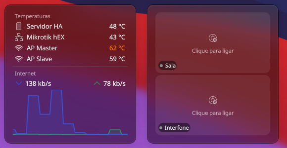
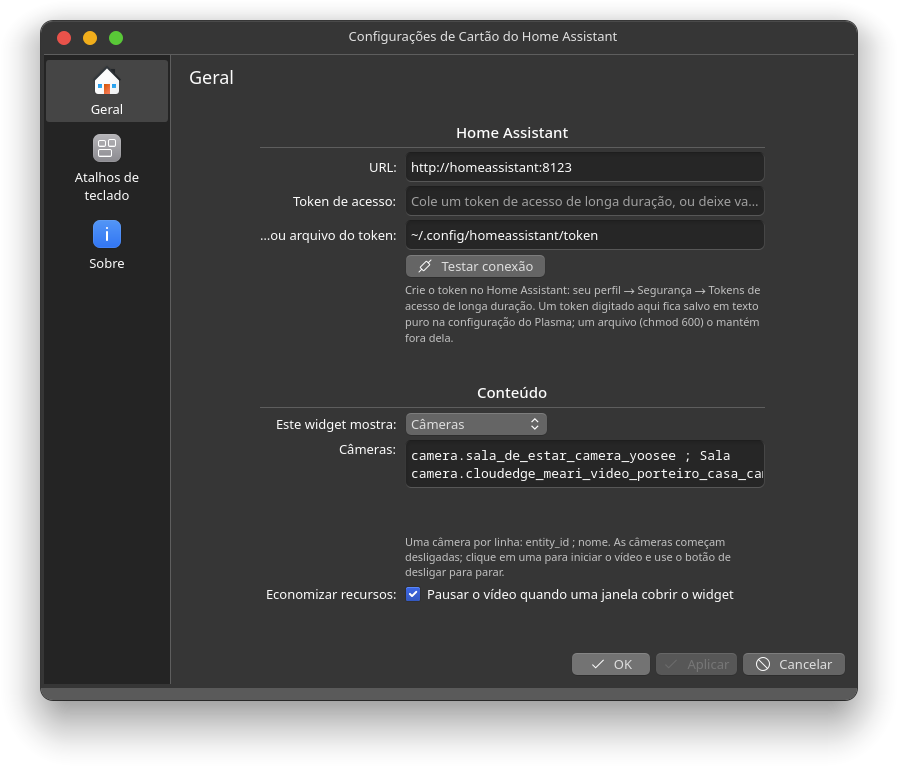

# Home Assistant Card for KDE Plasma 6

A desktop widget (plasmoid) that brings [Home Assistant](https://www.home-assistant.io/) to your KDE Plasma 6 desktop:

- **Sensors**: any entity (temperatures, humidity, power, text states…), with warning/critical colors for temperatures.
- **Network**: download/upload throughput from any data-rate sensor, with a small live chart.
- **Cameras**: live video from any Home Assistant camera, **on demand**. Cameras start turned off, so nothing streams until you click a camera, and the power button stops them. Video also pauses while a window covers the widget.



Add one instance per card. Each instance is either a *sensors* card or a *cameras* card.

> 🇧🇷 [Leia em português](#português)

## Requirements

### On Home Assistant

- Home Assistant reachable from this computer (e.g. `http://homeassistant.local:8123` or its IP)
- A **long-lived access token** (see [Setup](#setup))
- For cameras: the `stream` integration, which is on by default (`default_config`). Cameras should deliver **H.264**, because H.265/HEVC doesn't play here, in browsers or in the HA app (see [below](#how-cameras-work-and-their-latency))

### On Linux

- **KDE Plasma 6.0 or newer**. Tested on Arch Linux with Plasma 6.8 (Wayland).
- The QML modules below. Most of them already come with a full Plasma install; the ones you most likely need to add are **Qt Multimedia with FFmpeg** and **Qt WebSockets** (both only needed for cameras).

| What it's for | QML module | Arch | Debian / Ubuntu (Kubuntu) | Fedora |
|---|---|---|---|---|
| Plasma widget API | `org.kde.plasma.plasmoid`, `…components` | `libplasma` | `libplasma6` | `libplasma` |
| Reading the token file | `org.kde.plasma.plasma5support` | `plasma5support` | `qml6-module-org-kde-plasma-plasma5support` | `plasma5support` |
| Pausing when covered | `org.kde.taskmanager` | `plasma-workspace` | `plasma-workspace` | `plasma-workspace` |
| "Show desktop" detection | `org.kde.kwindowsystem` | `kwindowsystem` | `qml6-module-org-kde-kwindowsystem` | `kf6-kwindowsystem` |
| UI | `org.kde.kirigami` | `kirigami` | `qml6-module-org-kde-kirigami` | `kf6-kirigami` |
| Network chart | `org.kde.quickcharts` | `kquickcharts` | `qml6-module-org-kde-quickcharts` | `kf6-kquickcharts` |
| Settings page | `org.kde.kcmutils` | `kcmutils` | `qml6-module-org-kde-kcmutils` | `kf6-kcmutils` |
| **Camera video** | `QtMultimedia` | `qt6-multimedia` + **`qt6-multimedia-ffmpeg`** | `qml6-module-qtmultimedia` (FFmpeg is built in) | `qt6-qtmultimedia` (+ `ffmpeg-libs` from RPM Fusion for H.264) |
| **Camera streams** | `QtWebSockets` | `qt6-websockets` | `qml6-module-qtwebsockets` | `qt6-qtwebsockets` |
| `install.sh` | `kpackagetool6`, `python3` | `kpackage`, `python` | `kpackagetool6`, `python3` | `kf6-kpackage`, `python3` |
| Building translations (optional) | `xgettext`, `msgfmt` | `gettext` | `gettext` | `gettext` |

Only the Arch package names were checked on a real install. The Debian/Ubuntu and Fedora names follow each distro's usual naming and may differ between releases. If a module is missing, the widget shows an error saying which one, and `journalctl --user -u plasma-plasmashell -f` shows the details.

Quick install of the extras:

```bash
# Arch / Manjaro / EndeavourOS
sudo pacman -S --needed qt6-multimedia qt6-multimedia-ffmpeg qt6-websockets kquickcharts kcmutils plasma5support

# Debian 13 / Ubuntu 24.10+ (Kubuntu)
sudo apt install qml6-module-qtmultimedia qml6-module-qtwebsockets qml6-module-org-kde-quickcharts \
                 qml6-module-org-kde-kcmutils qml6-module-org-kde-plasma-plasma5support kpackagetool6

# Fedora KDE
sudo dnf install qt6-qtmultimedia qt6-qtwebsockets kf6-kquickcharts kf6-kcmutils plasma5support
```

## Install

```bash
git clone https://github.com/lucasborgestec/plasma-homeassistant-card.git
cd plasma-homeassistant-card
./install.sh
```

Then right-click the desktop → **Add or Manage Widgets** → **Home Assistant Card**.

To update later: `git pull && ./install.sh`, then restart Plasma (`systemctl --user restart plasma-plasmashell`).

## Setup

1. In Home Assistant, open your profile → **Security** → **Long-lived access tokens** → **Create token**.
2. Either paste the token in the widget settings, or (recommended) save it to a file that only you can read:
   ```bash
   mkdir -p ~/.config/homeassistant
   wl-paste -n > ~/.config/homeassistant/token   # or paste it with any editor
   chmod 600 ~/.config/homeassistant/token
   ```
   A token typed in the settings is stored in plain text in Plasma's config (`~/.config/plasma-org.kde.plasma.desktop-appletsrc`). The file keeps it out of there.
3. Open the widget settings, set the URL (e.g. `http://homeassistant.local:8123`), click **Test connection**, and pick what the widget shows.



### Sensors card

One entity per line, in the form `entity_id ; label ; icon`. Label and icon are optional: without a label the entity's friendly name is used, and without an icon one is picked from the device class.

```
sensor.server_cpu_temperature ; Server ; network-server-symbolic
sensor.router_temperature ; Router ; network-wired-symbolic
sensor.living_room_humidity
```

For the network section, set the **download** and **upload** entities (any sensor in `bit/s`, `kbit/s`, `Mbit/s`, `B/s`, `kB/s`, `MB/s`…).

### Cameras card

One camera per line: `camera.entity_id ; label`.

```
camera.front_door ; Front door
camera.living_room ; Living room
```

## How cameras work and their latency

The widget asks Home Assistant for an HLS stream over the websocket API (`camera/stream`), the same stream the HA frontend uses, and plays it with Qt Multimedia.

Qt's FFmpeg backend doesn't support Low-Latency HLS and starts a few segments behind live. With Home Assistant's default 6-second segments that's around **20 s of delay**. To bring it down to about **6–8 s**, add this to Home Assistant's `configuration.yaml` and restart it:

```yaml
stream:
  segment_duration: 2
```

Segments can only end on a keyframe, so the camera (or your go2rtc/transcoding setup) should send a keyframe every 1–2 s for this to help.

Cameras that only send **H.265/HEVC** won't play in browsers or the HA app either. Transcode them to H.264, for example with go2rtc (`#video=h264`).

## Privacy and resources

- The widget only talks to the Home Assistant URL you configure.
- When the cameras are off, the widget keeps no connection open for them. Home Assistant stops its stream worker a few seconds after the last viewer leaves.
- Sensors are polled with plain REST calls (`/api/states/<entity_id>`) at the interval you choose.

## Translations

The UI is in English with a Brazilian Portuguese translation. To add a language, copy `po/pt_BR.po` to `po/<lang>.po`, translate it, and run `./build-translations.sh`.

## License

[MIT](LICENSE)

---

## Português

Widget para o KDE Plasma 6 que mostra **sensores**, **tráfego de rede** e **câmeras ao vivo** do Home Assistant na área de trabalho. As câmeras começam desligadas: só transmitem quando você clica, e param no botão de desligar ou quando uma janela cobre o widget.

**Pré-requisitos:**
- Plasma 6 e Home Assistant acessível pela rede, com um token de acesso.
- Para as câmeras, também Qt Multimedia com FFmpeg e Qt WebSockets.

No Arch: `sudo pacman -S --needed qt6-multimedia qt6-multimedia-ffmpeg qt6-websockets kquickcharts kcmutils plasma5support`. A tabela completa por distro está em [Requirements](#requirements).

**Instalação:** `git clone https://github.com/lucasborgestec/plasma-homeassistant-card.git && cd plasma-homeassistant-card && ./install.sh`. Depois, clique com o botão direito na área de trabalho → **Adicionar widgets** → **Cartão do Home Assistant**.

**Configuração:**
1. Crie um token no Home Assistant: seu perfil → **Segurança** → **Tokens de acesso de longa duração**.
2. Cole o token nas configurações do widget, ou salve em `~/.config/homeassistant/token` com `chmod 600`.
3. Informe a URL do Home Assistant, clique em **Testar conexão** e liste as entidades, uma por linha (`entity_id ; nome ; ícone`).

**Atraso das câmeras:** por padrão fica em torno de 20 s. Com `stream: segment_duration: 2` no `configuration.yaml` do Home Assistant, cai para cerca de 6–8 s. Detalhes na seção em inglês acima.
